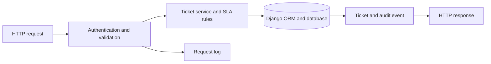

# Implementation notes

Django handles routing, migrations, transactions, and the test client. Pydantic validates JSON and query input. The ticket service applies role, lifecycle, SLA, and concurrency rules. Views serialize snapshots, pages, events, and metrics. The queue aggregate calculates all counts in one database statement.

| Situation | Decision and consequence |
| --- | --- |
| A client loses the creation response and retries. | A database constraint on actor and retry key enforces uniqueness. A SHA-256 fingerprint checks normalized input. |
| Two operators act on the same ticket snapshot. | PostgreSQL locks the row. The service checks the expected version and writes the ticket and event in one transaction. SQLite serializes write transactions and may return a retryable 503 under contention. |
| A ticket is downgraded or reopened. | Keep the earlier deadline to preserve elapsed time. A reopened ticket can immediately show a resolution breach. |
| Ticket text can contain sensitive data. | Access logs omit tokens, bodies and search strings. Audit changes contain operational fields. A deployment gateway must apply its own redaction and limits. |
| Reviewers have limited setup time. | Django's built-in test runner isolates migrated databases. SQLite supports a quick review and PostgreSQL exercises races. |
| Counts need to drive a decision. | The review added assignment-state filtering and deadline ordering so managers can retrieve the work behind a handoff count. |
| Edge inputs can produce ambiguous state. | Reject duplicate properties and query parameters. Preserve full timestamp precision and test exact deadlines. |

Framework references include [Django transactions](https://docs.djangoproject.com/en/5.2/topics/db/transactions/), [database notes](https://docs.djangoproject.com/en/5.2/ref/databases/), and the [Django test runner](https://docs.djangoproject.com/en/5.2/topics/testing/overview/).

## Limits and production roadmap

1. **Identity and deployment.** One token per actor with manual provisioning and rotation. Add SSO or short-lived credentials, TLS, rate limits, secret management, and restricted database roles before exposing the API.
2. **Audit and governance.** Audit has read-only API access and transactional writes. A privileged database user can alter history. Establish retention, restrict write access, test restores, and export events to write-protected storage.
3. **Workload at 10×.** Benchmark real PostgreSQL query patterns. Evaluate trigram search, cursor pagination, connection pooling, and periodic aggregate snapshots if query costs warrant them.
4. **Service operations.** Add working calendars, escalation notifications, and SLA policy versions. The warning window is evaluated from current configuration. Measure handoff time and breach accuracy in a real pilot.
